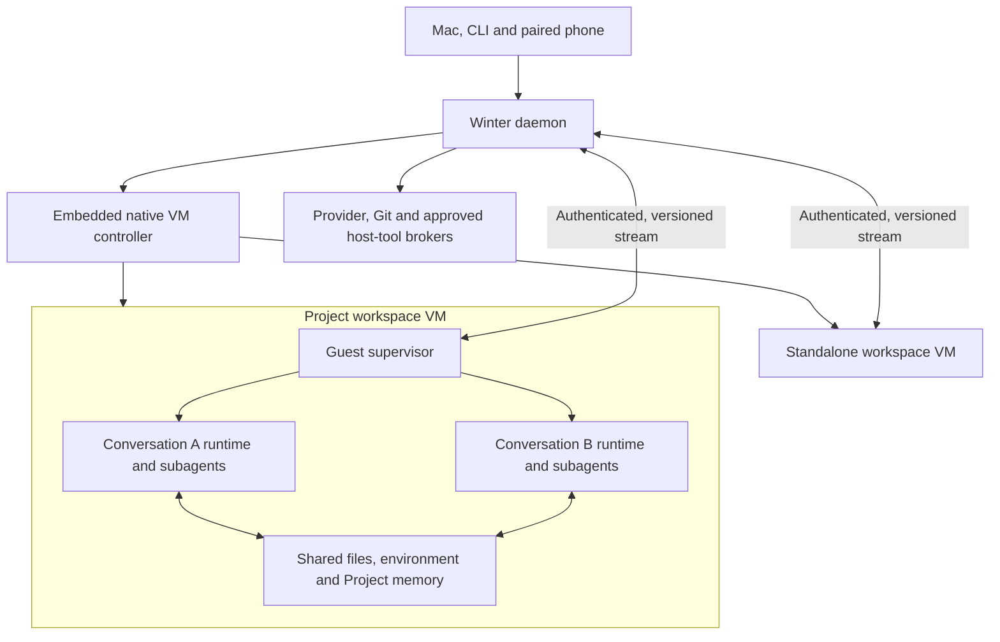

# Cowork working specification

Status: working specification and recommended build, updated 2026-10-11. Cowork is not implemented. The accepted requirements below come from the user; the build and behavioral defaults that follow are recommendations for adoption, not additional user decisions or implementation results. Automatic resource return is a feasibility requirement to validate, not an established property of the proposed backend.

## Accepted behavior

| Requirement | Contract |
| --- | --- |
| Standalone ownership | One durable workspace per Cowork conversation. |
| Projects | A reusable workspace shared by its conversations. This scope covers workspace functionality, not a complete Project collaboration/organization product. |
| Project concurrency | Separate conversations may run concurrently against the same workspace. A workspace-wide conversation queue is not the selected behavior. |
| Project messaging | Conversations in the same Project can message each other through SendMessage. |
| Concurrent edits | Use ordinary shared-filesystem/Git behavior. Agents coordinate and choose worktrees themselves; no new Cowork locking or transactional conflict-management layer. |
| Project memory | Conversations share persistent Project memory. Their logical transcripts remain separate and are not automatically concatenated into one context. Shared files/memory do not establish confidentiality between conversations. |
| Resource management | No manual per-VM CPU/RAM/GPU allocation workflow. Aim for automatic use of available host capacity and return of unused resources, with actual VM ceilings and reclaim limits stated explicitly. |
| Execution | Winter's agent loop and its subagents run inside a VM. Guest OS and backend remain architecture choices. |
| Host process preference | Avoid a Winter-owned host process per conversation; prefer VM controllers inside the existing daemon. Apple-managed VM execution services must be distinguished from Winter-owned controller processes. |
| Workspace inputs | At least one explicitly allowed host directory or one selected GitHub repository. A GitHub account connection alone is not a selected repository. Combining directories and repositories is allowed. |
| Host folders | Granted writable folders are edited directly. Changes already made to host files survive VM deletion or rollback. |
| GitHub work | Selected repositories are cloned by guest execution into workspace storage and retain uncommitted work/local commits. Commit and push must be supported, with publication authority specified separately. |
| Activity | Preserve Code's Active/Background/Idle/Archived vocabulary and behavior. VM power is a separate state; an attached idle conversation must not be mistaken for busy guest compute. |
| Stop and resume | Prefer cold stop when genuinely quiescent, preserving durable files and logical agent continuation. Arbitrary processes, sockets and RAM are not promised to survive cold stop. |
| Subagents | Run inside the owning VM, inherit its access ceiling, and remain addressable by their durable identity after restart. |

## Recommended baseline

Use the Apple Containerization **library**, backed by Virtualization.framework, with Linux ARM64 guests on Winter's existing macOS 26 platform. Keep a small backend interface so direct VZ can replace the library if the feasibility work finds a concrete incompatibility. Avoid an external `container` CLI/service dependency in the shipped path.

Use **one VM per durable workspace**. A standalone conversation gets its own workspace/VM; a Project gets one workspace/VM used concurrently by its conversations. Run one Winter runtime process per conversation **inside the guest**, with that runtime's subagents in-process as today. Separate processes improve cancellation and context bookkeeping, while the Project VM remains the shared trust and failure boundary.

Load a native Swift controller into the existing daemon. Prefer a small Node-API adapter with asynchronous operation IDs and an event/FD channel; keep the binding thin and validate it in the signed compiled daemon. Native VM operations run on their required queues rather than invoking JavaScript directly from VZ callbacks. A shared native helper is a fallback only if embedded integration fails its gate, and would require revisiting the controller-placement preference. Apple-managed backing processes remain outside the promise about Winter-owned processes.

Containerization provides image/init/process machinery, and its inspected source has a writable-layer abstraction and an `exec` API for additional processes in a running environment. This supports the proposed shape without relying on experimental LinuxPod hotplug. It is not proof of Winter's durability, isolation or cancellation behavior. [Containerization overview](https://github.com/apple/containerization), [pinned process/storage source](https://github.com/apple/containerization/blob/bc994b88df46207fad7775b0eabc51947e315881/Sources/Containerization/LinuxContainer.swift), [Node-API support](https://bun.com/docs/runtime/node-api), [VZ queue contract](https://developer.apple.com/documentation/virtualization/vzvirtualmachine/queue?language=objc)



See the [options comparison](research/2026-10-10-cowork-vm-options.md) for alternatives. Nested VMs, unrelated workspaces sharing one guest kernel, remote execution and macOS guests remain future directions unless a concrete requirement changes this baseline.

## Ownership and authority

| Owner | Responsibility |
| --- | --- |
| Host daemon | Workspace manifests, canonical UI transcript/events, approvals, grants, resource admission, schedules, credential authority and recovery UI |
| Native controller | VM objects and lifecycle, explicit disks/shares/network configuration, versioned transport, native resource cleanup |
| Guest supervisor | Conversation process launch, authenticated stream routing, task/process ownership, occupancy, drain/flush handshake and connection-loss handling |
| Guest conversation runtime | Agent loop, its own subagents and SDK store, tools and conversation-local control state |
| Workspace storage | Shared Project files/memory/environment plus distinct per-conversation state, scratch and outputs |

A workspace has one guest/disk owner but may have many active conversations. The owner lease prevents attaching its writable disks twice; it does not serialize Project conversations. Keep `workspaceId`, `sessionId`, `guestIncarnationId`, lease epoch, grant revision, image digest and runtime version separate.

The host determines workspace and launch identity from the authenticated channel and controller state. Guest-supplied IDs or claimed approvals are not authority. Run agent workloads non-root and keep the supervisor control interface out of their general tool surface. Cross-workspace grants remain denied even if guest code invents another workspace/session ID.

All Project mounts and shared memory belong to the Project's explicit grant set. Adding a folder grants the Project access, including its other conversations and subagents. Do not silently union supposedly private conversation grants. Distinct runtime homes and transcripts prevent accidental context mixing; they do not promise adversarial confidentiality inside one shared guest.

## Persistent storage and environment

Use a shared immutable base-image cache, a persistent writable environment layer per workspace, and a separate persistent data volume. Retain installed tools/packages and environment changes across normal cold stops. Pin the writable environment to its base-image digest; a new base cannot silently replace the lower layer beneath an old installation overlay.

Proposed guest layout:

| Location | Purpose and lifetime |
| --- | --- |
| `/workspace/repos/<repo-id>` | Persistent guest-cloned repositories, including dirty files, local commits and Git worktrees |
| `/workspace/folders/<grant-id>` | Explicit host-folder mounts; read-only/read-write as granted |
| `/workspace/.winter/conversations/<session-id>` | That conversation's durable SDK home, parent/child transcripts, metadata and replay state |
| `/workspace/.winter/memory` | Shared Project MEMDIR; standalone conversations get their own workspace memory |
| `/workspace/.winter/scratch/<session-id>` | Persistent conversation TMPDIR |
| `/workspace/outputs/<session-id>` | Durable outputs, accessible through the host artifact bridge |
| Guest `/tmp` | Disposable OS/boot scratch, with no cold-restart persistence promise |

The host owns the manifest and volume files beneath a Cowork workspace directory. Mount each ordinary writable disk into at most one guest. Materialize runtime configuration/run homes using guest paths, not host symlinks or Mac cwd strings. Separate conversation runtime identity from the shared Project memory path.

### Where the restored state lives on the Mac

The following Cowork paths are proposed; they have not been created by this specification work. `WINTER_HOME` defaults to `~/.winter`; selecting a profile alone does not change the home.

```text
<WINTER_HOME>/
  cache/cowork/images/<image-digest>/     shared immutable image/kernel assets
  cowork/workspaces/<workspace-id>/
    manifest.json                       identity, volume references, versions, grants
    env.ext4                            persistent writable environment layer
    data.ext4                           persistent workspace data volume
```

`data.ext4` is an ordinary file on the Mac used as a virtual disk and mounted at `/workspace` inside the guest. It contains cloned repositories, worktrees, shared memory, the per-conversation SDK stores (including subagents), scratch and outputs listed above. `env.ext4` retains installed packages and environment changes, paired with the selected base image. The exact storage format/layout is an implementation detail to validate; the durable ownership contract is not optional. Images may use sparse backing; deleted guest files do not imply immediate host disk-space reclamation.

Selected Mac folders stay at their original Mac paths, outside these images. They are mounted into `/workspace/folders/<grant-id>`; their direct edits are not copied back from a private snapshot and are not rolled back with the VM.

The existing host event log is `<WINTER_HOME>/sessions/<scope>/<session-id>.jsonl`, with its index in `<WINTER_HOME>/sessions/index.db`. Existing runtime directory/mailbox/delivery infrastructure uses `<WINTER_HOME>/runtimes/runtime-state.db`; reuse/evolve it for the new messaging contract where appropriate. These host records remain readable while the guest is stopped. Existing Code runtime SDK files normally live under `<WINTER_HOME>/sdk/projects`; Cowork's proposed guest SDK homes are a distinct location. [Host session storage](../packages/core/src/sessions/store.ts), [host paths](../packages/core/src/winter-dir.ts), [runtime home paths](../packages/core/src/agent/paths.ts)

Cold restoration means: load the host manifest, create a new VM incarnation, attach the retained base/environment/data, revalidate and mount current folder grants, then start Winter and restore its parent/subagent histories and identities from the SDK stores. It does **not** restore a RAM snapshot. There is no required `.vmstate` memory-dump file in this baseline, and old sockets/process stacks do not survive. If the guest data volume is lost, a readable host transcript alone does not establish complete SDK continuation.

Scratch and outputs survive ordinary stop/archive. Reclaim only explicitly disposable caches automatically; deletion or retention policies must not silently remove uncommitted work, transcripts, memory or outputs. Workspace deletion never deletes granted host folders or their already-applied edits.

Image/runtime updates occur while stopped. Validate compatibility, retain the previous environment until migration or explicit rebuild succeeds, and preserve workspace data. A VM/image rollback cannot undo direct host-folder writes.

## Concurrent Project work

Run independent Project conversations concurrently. No workspace-wide turn queue is introduced.

Use normal shared-filesystem behavior, just as two Code sessions or external editors can edit the same files. Agents coordinate through SendMessage and decide whether independent branches or overlapping edits warrant worktrees. Winter does not add a Cowork-specific per-file lock, transactional stale-edit check or automatic conflict-resolution service. Existing tool semantics and normal filesystem/Git locks and errors still apply.

Project memory is ordinary shared durable Markdown/files under MEMDIR. Agents choose its organization and coordinate edits themselves; no separate transactional memory service is required. Separate transcripts do not prevent information from being deliberately written into shared Project memory.

## Same-Project SendMessage

The host daemon authenticates the sender, resolves the target by durable session identity and verifies Project membership from its own records. Project membership enables peer messaging within that Project; cross-Project messaging needs its separate applicable authority. An unknown target returns `not_found` and never creates a conversation. Messages are attributed as agent messages and execute under the recipient's current policy/grants.

| Recipient | Recommended delivery behavior |
| --- | --- |
| Working | Steer through the existing Code-compatible input behavior when supported; otherwise queue behind its current work |
| Idle with a runtime | Start a turn in that conversation |
| Stopped but resumable | Wake the workspace if necessary, restore the existing conversation, and deliver through its new incarnation |
| Archived | Refuse automatic wake until explicitly restored |
| Deleted or unknown | Refuse; do not recreate the conversation |
| Blocked by grants/resources/recovery | Retain a visible pending or blocked receipt according to policy; never fall back to an unrelated host session |

Persist acceptance and assign a stable receipt before returning accepted/queued success. Accepted means the daemon owes delivery; delivered means the recipient durably acknowledged the input, not that the model read it or completed the work. Retries with the same send identity return the retained receipt; conflicting reuse is refused. Retain unresolved/uncertain records until resolved or explicitly canceled. Define bounded retention for terminal deduplication records; do not promise exactly-once execution or external effects.

Wake and delivery obey workspace admission, disk ownership, grant validation and incarnation/lease epochs. Runnable queued delivery participates in occupancy; blocked host-only inbox records do not by themselves require a live VM. Existing host-session messaging provides steer/queue/resume behavior but currently has process-local deduplication. Existing generic router mailboxes/delivery records are durable infrastructure, not already an implemented Project messaging contract. [Session broker](../packages/core/src/agent/session-messaging.ts), [router directory store](../packages/core/src/runtime-state/directory-store.ts)

## Repository behavior

At creation, choose explicit repositories and starting refs; create the checkout once. Standalone work may start on a conversation branch. Project conversations continue the workspace's current branches, HEADs, index and dirty state. Starting or reopening a conversation does not re-clone, reset, stash or switch branches.

Agents decide how to stage changes, commit, switch branches and coordinate use of a shared checkout. Normal Git locking, dirty-tree checks and errors apply. Winter does not add another Git mutation-locking layer or refuse an operation merely because another Project conversation is active.

Worktrees are an agent/user choice for separate branch work. Preserve existing worktrees and dirty state on reopen; do not automatically move conversations into private copies. Git publication permissions remain an authority concern separate from concurrent-edit coordination.

Clone/fetch/local work follows the current workspace/tool policy. Push, PR creation, merge, protected-branch writes and history rewrites use their own current authority. An explicit user instruction or saved grant can authorize an action without asking again. Account connection alone grants neither every repository nor unrestricted publication. Branch-limited publication must be enforced by the Git broker; a repository-wide token alone does not establish a branch limit.

## Credentials, host access and revocation

Keep provider/Git credentials on the host and expose scoped broker operations to the guest. Provider requests are constrained to approved providers/models and concrete destinations; Git requests to approved repositories/ref operations. Validate redirects and operation authority on the host. Existing host credential callbacks can transfer credential material to a runtime, so they cannot be reused unchanged to promise credential-free guest configuration.

Offer guest-native filesystem, shell, search and workflow execution first. Use an explicit Linux/VM execution posture; unsupported macOS sandbox code must fail rather than silently disable required protection or fall back to executing on the Mac. No automatic host home, SSH agent, Keychain or daemon-socket mount.

Recommend ordinary outbound Internet access for browsing and dependencies, while private host/LAN services need explicit capabilities or network grants. Local model endpoints are mapped deliberately through the host broker. This egress policy is a proposed product choice and needs enforcement tests; keeping credentials on the host alone does not control outbound data.

Host browser/office/computer capabilities are separate explicit opt-ins. They receive bounded artifacts or validated grant/location references, never arbitrary guest strings reinterpreted as privileged Mac paths. The artifact bridge exposes stable `{workspaceId, locationId, relativePath}` identities with traversal, symlink and content-size checks.

Revoke broker authority immediately. If a removed folder can remain accessible through open guest descriptors, stop affected work and restart the whole workspace VM without that share before reporting revocation complete. Other Project conversations receive the interruption reason because the grant/VM is shared. Files already read or changed cannot be recalled by unmounting. Removing Git remote authority preserves local checkout data unless deletion is separately requested.

## Activity, cold stop and recovery

Keep Code's activity derivation and attachment semantics. VM power is separate: `stopped`, `starting`, `running`, `quiescing`, `stopping`, `failed/recovery-required`. Reading the transcript does not require a live guest. An attached conversation may remain Active while its VM is stopped; an idle background label does not itself hold compute awake.

Recommend attempting automatic cold stop after **two minutes of continuous workspace-wide quiescence**. This is a tunable starting value, not the existing Code activity grace period or a measured optimum.

Occupancy includes every conversation turn, active subagent generation, task-owned process/shell, workflow/monitor, tool request, pending approval, runnable queued input/delivery and filesystem operation in the workspace. Infrastructure such as init, the supervisor and idle runtime processes does not itself count as work. Blocked host-only inbox entries and future schedules do not themselves hold guest compute. Unknown task ownership or an unresponsive guest is not idle.

Stop protocol: close new-work admission for the current epoch; drain guest work; flush parent/child/provider state and files; confirm host event ingestion through the final guest sequence; then stop, detach storage and dispose live VM resources. The stopped workspace retains files/metadata, not an allocated guest RAM snapshot. Retain disk ownership until termination is confirmed. Input arriving before shutdown commits cancels quiescing; input after that boundary is durably queued for the next incarnation. Stale callbacks, schedule claims and stop acknowledgments cannot act on a newer epoch.

Pending approval callbacks keep the guest occupied in v1. Sleeping while waiting for approval requires a later durable suspend/rebind protocol; it cannot be obtained by treating a live callback as a host-only record. Scheduled work that needs missing authority should block visibly rather than silently become `auto`.

A new message or due schedule boots/resumes the workspace, revalidates grants/current policy and restores the same conversation/subagent identities. No live shell/socket/RAM continuity is promised. Clean stop has a durable flush contract; hard crashes recover from available durable state and mark uncertain effects for reconciliation. Event deduplication does not establish exactly-once external side effects.

On daemon loss, the replacement daemon must establish that the old guest has stopped before reopening its writable disks; a stale lease timestamp or dead controller PID alone is not proof. Guest PIDs can repeat across boots, so runtime-owned leases need incarnation/boot identity reconciliation before new runtimes start; a guest PID is never a Mac process ID. This is separate from ordinary user Git locks, which follow normal Git behavior. Corrupt/missing stores, disk exhaustion or incompatible images produce a recoverable error and preserve evidence instead of silently starting a new conversation.

## Host-owned scheduling

Put all timers and canonical schedule records in the daemon. Guest Cron and ScheduleWakeup tools must create/list/delete the same durable authority and report success only after host acceptance. Preserve one-shot versus recurring intent, timezone, target workspace/session, grant ceiling, overlap policy, occurrence ID and run status. Replace the current result-mirroring/process-local ID mapping path rather than layering another scheduler over it.

Recommended targeting: an agent-created wakeup continues its existing conversation; a user recurring routine normally creates a fresh conversation in a selected Project. A standalone schedule explicitly targets its existing conversation, since fresh standalone conversations otherwise mean new workspaces. Scheduling does not switch a shared checkout's branch; branch-sensitive jobs carry a precondition and block on mismatch.

Allow different Project conversations/jobs to overlap. For one recurring job, default to at most one active occurrence plus one coalesced pending occurrence, with missed counts visible. One-shots remain pending until handled, canceled or explicitly expired. Persist claims so daemon restarts cannot concurrently launch the same occurrence twice. An uncertain already-dispatched effect requires recovery, not blind replay.

Use current grants and policy within the schedule's saved authority ceiling; store credential references/intent rather than reusable credentials. Give schedule-origin turns explicit automated-turn protection so a terminal that merely watches them cannot abort them. The Mac and daemon must be able to run; local scheduling does not promise execution while the Mac is asleep or powered off.

Recommend pausing schedules targeting an archived conversation and refusing automated peer wake while other Project conversations continue. Archiving a Project pauses its jobs and drains its workspace when safe. Archive preserves data; deletion is separate. Deleting one conversation does not delete shared Project files/memory or granted host folders.

## Resource policy and product surfaces

Cowork manages resources automatically; users do not carve out RAM or CPU/GPU cores for each VM. Winter selects necessary boot ceilings internally and uses host pressure plus guest demand to admit work. Concurrent Project conversations already share the same guest's resources.

CPU counts are virtual execution limits, not exclusive physical-core reservations. macOS schedules guest and host work against the same hardware. A configured guest RAM size reserves host virtual address space; physical backing is allocated on demand, but the guest still has a configured ceiling. No supported live vCPU resizing or unlimited RAM hot-add is assumed. [Apple resource scheduling](https://github.com/apple/container/blob/f70ecbb926d925818a34917529e304b1177ce98c/docs/resource-usage.md#overcommit-memory-and-cpus-across-containers), [VZ memory size](https://developer.apple.com/documentation/virtualization/vzvirtualmachineconfiguration/memorysize)

Automatic **return** of memory is a blocking feasibility question. Apple's current container documentation says pages freed inside Linux are not automatically relinquished to macOS. VZ's traditional balloon device can request pages back and make memory available again within the configured ceiling, but the guest may not comply. The inspected Containerization backend has extension hooks where Winter can add balloon support; its default backend does not establish that behavior. Kernel balloon/page-reporting flags alone are not proof of actual reclaim. [Current limitation](https://github.com/apple/container/blob/f70ecbb926d925818a34917529e304b1177ce98c/docs/technical-overview.md#releasing-container-memory-to-macos), [balloon target](https://developer.apple.com/documentation/virtualization/vzvirtiotraditionalmemoryballoondevice/targetvirtualmachinememorysize), [VZ extension points](https://github.com/apple/containerization/blob/bc994b88df46207fad7775b0eabc51947e315881/Sources/Containerization/VZVirtualMachineInstance.swift)

Recommend a host-wide automatic resource controller that observes pressure/demand, requests unused memory back where verified, and stops/disposes only fully idle guests through the durable lifecycle. Do not silently restart occupied guests to shrink memory, rely on host swapping as evidence of successful reclaim, or advertise seamless elastic RAM before it is demonstrated. If a workload exceeds its boot ceiling, report the constraint and arrange a safe resize/restart boundary rather than pretending it can grow without limit.

A single shared Linux VM is an alternative for a common guest memory pool across all workspaces. It allows one workspace to reuse memory freed by another inside Linux, but does not by itself solve return to macOS and changes the per-workspace kernel/failure boundary. It has not been selected by this requirement.

No GPU-core allocation UI is proposed. The standard Linux VZ graphics path is Virtio GPU 2D, not documented Apple Metal compute passthrough. Approved GPU work could use a host Metal/local-model service or a remote GPU capability later; arbitrary guest GPU programs are not promised to work through that bridge. This is separate from CPU/RAM sharing. [Apple's Linux and macOS graphics distinction](https://developer.apple.com/videos/play/wwdc2022/10002/)

Admit work against actual CPU/RAM/disk pressure and protect the host from overload. Capacity waiting is visible and distinct from serializing a Project's conversations. Never silently evict an occupied VM to start another. Preserve state on resource failures, and block destructive automatic cleanup when persistence is already failing. Measure allocated/freed guest pages, real host footprint, balloon compliance, page cache, swap and competing guests before declaring automatic resource behavior ready.

The UI exposes workspace/Project identity, shared grants, running conversations, preparing/starting/ready/sleeping/recovery state, files/outputs, repo state and schedules. It must show that a Project grant or VM restart affects all its conversations. Mac creates local folder grants; paired clients can use authorized existing workspaces and supported repository flows. Phone control still targets the Mac's daemon/VM, not a phone-local guest.

Retain only the workspace portion of Projects in this scope. Keep Code behavior intact while adding an explicit Cowork mode; unknown/unsupported Cowork execution must not silently map to host Code execution. Do not enable a placeholder solely by changing an availability flag.

## Build order and acceptance gates

1. **Native/authority/resource slice:** signed compiled daemon plus pinned Containerization, Linux guest and authenticated supervisor channel; disposable folder fixtures and mocked credentials only. Prove confinement/revocation, actual host/guest process topology and genuine memory reclaim behavior before finalizing the backend or attaching user data.
2. **Durable execution slice:** Linux Winter artifact, guest run-home/transport, explicit guest sandbox posture, two concurrent Project conversations, independent cancellation, durable files/environment/memory, and real cold parent/child continuation. Release/pin the SDK prerequisite as a separate authorized integration step and complete shutdown/resume ownership gates needed for auto-stop.
3. **Workspace behavior:** folder/repo creation, ordinary shared filesystem/Markdown/Git behavior, same-Project peer messaging, provider/Git brokers, artifacts, image compatibility, crash recovery and automatic resource management.
4. **Scheduled/UI flows:** one canonical host scheduler, Mac/CLI/paired-client flows, activity parity, archive/delete behavior and end-to-end support through real supported creation doors.

Before exposing Cowork, verify: two unrelated guests cannot cross grants; two Project conversations really overlap and can message one another; agents can choose shared checkouts or worktrees without a Cowork locking layer; stopping one conversation does not stop another; peer delivery survives a stopped recipient and daemon restart without creating a new identity; revocation removes access after the required restart; idle detection includes detached work; wake/stop races start exactly one valid incarnation; dirty repos and memory survive cold stop; SDK SendMessage continues the same child after actual process/VM restart; schedule IDs survive daemon restart; disk-full and interrupted-effect recovery stay truthful; automatic resource claims match measured host behavior; and events/approvals remain correctly associated with their conversations.

Measure first image provisioning, prepared VM boot, Winter-ready latency, repo setup and steady-state resource use separately. Apple's sub-second lightweight-guest startup description is not a Winter readiness benchmark. [Apple Containerization design](https://github.com/apple/containerization#design)

Implementation spans Winter's protocol/daemon/native packaging and Mac UI, agent SDK guest execution/lifecycle, runtime SDK Cowork/run-home/transport support, and iOS protocol/client surfaces. Apply the repository's protocol producer/consumer and Swift mirror checklists when implementation is authorized. No VM or implementation experiment is performed by this specification work.

## Implemented prerequisite, not Cowork implementation

[Agent SDK PR #2](https://github.com/yanlingLabs/winter-agent-sdk/pull/2) merged as `ec8012b5` at reviewed head `27f1c43e`. It adds durable subagent continuation with current authority checks and interrupted-history repair. It has not been released or pinned into Winter in this work. Root-shutdown ownership/timeout handling, typed refusal codes, fork snapshot deduplication and a worktree re-entry case remain follow-ups.

The [implementation map](cowork-status.md) separates existing host/UI infrastructure from unimplemented Cowork execution. The [research record](research/2026-10-10-cowork-vm-research.md) preserves source evidence, earlier proposals and accepted changes. This specification must not be used to enable Cowork before its execution and acceptance gates are implemented.
