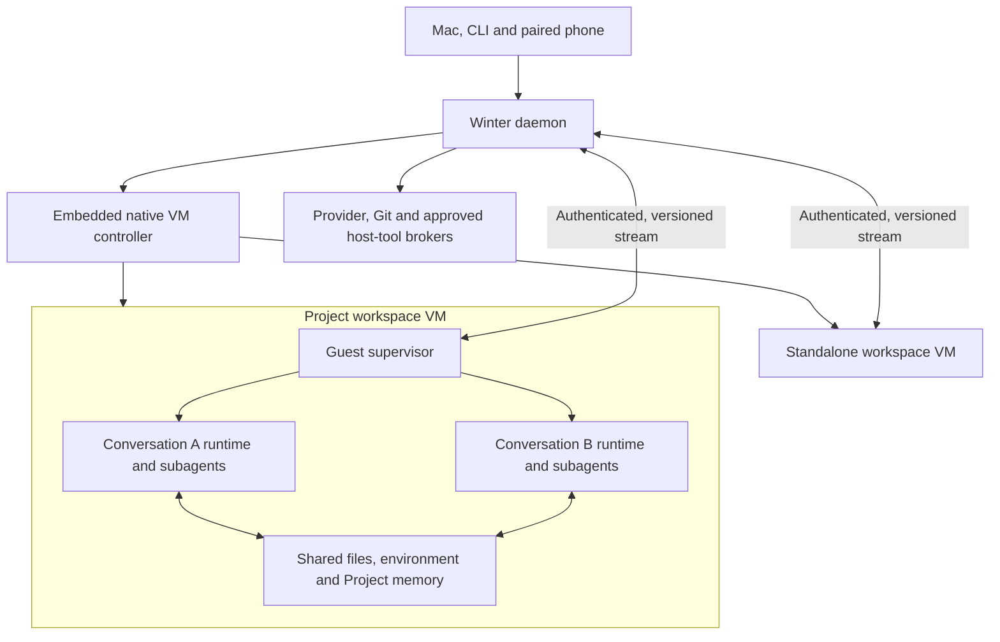

# Cowork working specification

Status: user-approved design direction, updated 2026-10-11. Cowork is not implemented. The user accepted this specification's direction and the source/publication decisions below; detailed mechanisms remain proposed until validated. Approval of the specification does not authorize implementation. Automatic resource return is a feasibility requirement to validate, not an established property of the selected backend direction.

The [host records and protocol inventory](cowork-host-protocol.md) defines canonical state, RPCs/events and local/paired-client access. The [execution and integration contracts](cowork-execution-contracts.md) are part of this specification: Linux confinement, policy/messaging matrices, guest router/file readers, extensions/trust, provider/Git gateways, network enforcement and lifecycle/retention. The [independent review ledger](research/2026-10-11-cowork-spec-review.md) tracks the gaps those contracts address. No review or document edit establishes that a feasibility gate passed.

Independent review accepted specification commit `21e3e5f4` for planning gates 1–4 with no remaining blocker. The [review ledger](research/2026-10-11-cowork-spec-review.md#acceptance-of-21e3e5f4-and-planning-follow-ups) records that acceptance and the subsequent non-blocking protocol clarifications. Feasibility and implementation remain unproven.

## Accepted behavior

| Requirement | Contract |
| --- | --- |
| Standalone ownership | One durable workspace per Cowork conversation. |
| Projects | A reusable workspace shared by its conversations. This scope covers workspace functionality, not a complete Project collaboration/organization product. |
| Project concurrency | Separate conversations may run concurrently against the same workspace. A workspace-wide conversation queue is not the selected behavior. |
| Project messaging | Conversations in the same Project can message each other through SendMessage. |
| Concurrent edits | Use ordinary shared-filesystem/Git behavior. Agents coordinate and choose worktrees themselves; no new Cowork locking or transactional conflict-management layer. |
| Project memory | Conversations share persistent Project memory. Their logical transcripts remain separate and are not automatically concatenated into one context. Shared files/memory do not establish confidentiality between conversations. |
| Resource management | No manual per-VM CPU/RAM/GPU allocation workflow. Aim for automatic use of available host capacity and return of unused resources, with actual VM ceilings and reclaim limits stated explicitly. |
| Execution | Winter's agent loop and its subagents run inside a Linux VM, using the Containerization/VZ direction below, subject to its feasibility gates. |
| Host process preference | Avoid a Winter-owned host process per conversation; prefer VM controllers inside the existing daemon. Apple-managed VM execution services must be distinguished from Winter-owned controller processes. |
| Workspace inputs | At least one explicitly allowed host directory or one selected GitHub repository. A GitHub account connection alone is not a selected repository. Combining directories and repositories is allowed. |
| Changing inputs | Users may add repositories and folders during a conversation. They may remove sources, but at least one source must remain; add a replacement before removing the last source. Project changes affect every conversation in that workspace. |
| Host folders | Granted writable folders are edited directly. Changes already made to host files survive VM deletion or rollback. |
| GitHub work | Selected repositories are cloned by guest execution into workspace storage and retain uncommitted work/local commits. In GitHub-only workspaces, automatically commit completed work and push feature branches. Main/default/protected branches, merges and force-pushes require separate authority. |
| Workspace instructions | Load a shared workspace WINTER.md for every conversation and subagent, plus applicable repository/directory WINTER.md files through normal Code discovery. Keep enforceable authority outside editable instructions. |
| Activity | Preserve Code's Active/Background/Idle/Archived vocabulary and behavior. VM power is a separate state; an attached idle conversation must not be mistaken for busy guest compute. |
| Stop and resume | Prefer cold stop when genuinely quiescent, preserving durable files and logical agent continuation. Arbitrary processes, sockets and RAM are not promised to survive cold stop. |
| Subagents | Run inside the owning VM, inherit its access ceiling, and remain addressable by their durable identity after restart. |

## Architecture baseline

Use the Apple Containerization **library**, backed by Virtualization.framework, with Linux ARM64 guests on Winter's existing macOS 26 platform. Keep a small backend interface so direct VZ can replace the library if the feasibility work finds a concrete incompatibility. Avoid an external `container` CLI/service dependency in the shipped path.

Use **one VM per durable workspace**. A standalone conversation gets its own workspace/VM; a Project gets one workspace/VM used concurrently by its conversations. Run one Winter runtime process per conversation **inside the guest**, with that runtime's subagents in-process as today. Separate processes improve cancellation and context bookkeeping, while the Project VM remains the shared trust and failure boundary.

Load a native Swift controller into the existing daemon. Prefer a small Node-API adapter with asynchronous operation IDs and an event/FD channel; keep the binding thin and validate it in the signed compiled daemon. Native VM operations run on their required queues rather than invoking JavaScript directly from VZ callbacks. A shared native helper is a fallback only if embedded integration fails its gate, and would require revisiting the controller-placement preference. Apple-managed backing processes remain outside the promise about Winter-owned processes.

Containerization provides image/init/process machinery, and its inspected source has a writable-layer abstraction and an `exec` API for additional processes in a running environment. This supports the proposed shape without relying on experimental LinuxPod hotplug. It is not proof of Winter's durability, isolation or cancellation behavior. [Containerization overview](https://github.com/apple/containerization), [pinned process/storage source](https://github.com/apple/containerization/blob/bc994b88df46207fad7775b0eabc51947e315881/Sources/Containerization/LinuxContainer.swift), [Node-API support](https://bun.com/docs/runtime/node-api), [VZ queue contract](https://developer.apple.com/documentation/virtualization/vzvirtualmachine/queue?language=objc)

This is Apple's lightweight, sub-second-start design, using an optimized Linux kernel and minimal init/root filesystem. It is not a measured promise that Winter is ready within a second: measure cached guest boot, mount setup, Winter/conversation restoration, first image provisioning and repository cloning separately. [Apple's startup description](https://github.com/apple/containerization#design)



See the [options comparison](research/2026-10-10-cowork-vm-options.md) for alternatives. Nested VMs, unrelated workspaces sharing one guest kernel, remote execution and macOS guests remain future directions unless a concrete requirement changes this baseline.

## Ownership and authority

| Owner | Responsibility |
| --- | --- |
| Host daemon | Canonical workspace/authority DB, nonauthoritative storage manifests, UI events, approvals, grants, admission, schedules, credential authority and recovery UI |
| Native controller | VM objects and lifecycle, explicit disks/shares/network configuration, versioned transport, native resource cleanup |
| Guest supervisor | Protected conversation launch, portable guest router/run-home materialization, confined tool process ownership, authenticated file/event transport, occupancy, drain/flush and recovery |
| Guest conversation runtime | Agent loop, its own subagents and SDK store, tools and conversation-local control state |
| Workspace storage | Shared Project files/memory/environment plus distinct per-conversation state, scratch and outputs |

A workspace has one guest/disk owner but may have many active conversations. The owner lease prevents attaching its writable disks twice; it does not serialize Project conversations. Keep `workspaceId`, `sessionId`, `guestIncarnationId`, lease epoch, grant revision, image digest and runtime version separate.

The host determines workspace and launch identity from the authenticated channel and controller state. Guest-supplied IDs or claimed approvals are not authority. Protect supervisor/runtime identities and immutable code separately from confined tool processes; non-root alone is insufficient when Bash can access the runtime's files. Tool code cannot edit run homes, SDK authority snapshots, peer stores or protected shared instructions. Apply the [Linux boundary and policy matrices](cowork-execution-contracts.md#authority-and-linux-execution-boundary) to every execution path. Cross-workspace grants remain denied even if guest code invents another workspace/session ID.

All Project mounts and shared memory belong to the Project's explicit grant set. Adding a folder grants the Project access, including its other conversations and subagents. Do not silently union supposedly private conversation grants. Distinct runtime homes and transcripts prevent accidental context mixing; they do not promise adversarial confidentiality inside one shared guest.

## Persistent storage and environment

Use a shared immutable base-image cache, a persistent writable tool environment per workspace, a separate persistent data volume, and narrow host-backed shares for guidance/memory/outputs. Retain installed tools/packages across normal cold stops. Trusted Winter/supervisor/router code is supplied separately read-only, version-locked to the host's required SDK/protocol; packages cannot replace or shadow it. Pin the writable environment to its base-image digest; a new base cannot silently replace the lower layer beneath an old installation overlay.

Proposed guest layout:

| Location | Purpose and lifetime |
| --- | --- |
| `/workspace/repos/<repo-id>` | Persistent guest-cloned repositories, including dirty files, local commits and Git worktrees |
| `/workspace/folders/<grant-id>` | Explicit host-folder mounts; read-only/read-write as granted |
| `/workspace/.winter/WINTER.md` | Protected alias to host-backed shared instructions, read-only to tools, loaded for every conversation/subagent independently of cwd |
| `/workspace/.winter/conversations/<session-id>` | Real guest SDK directory, owned by the protected runtime and omitted from general tool filesystem views |
| `/workspace/.winter/memory` | Host-backed shared Project MEMDIR; standalone conversations get their own workspace memory |
| `/workspace/.winter/scratch/<session-id>` | Persistent conversation TMPDIR |
| `/workspace/outputs/<session-id>` | Host-backed durable outputs, readable through the artifact bridge while the VM is stopped |
| Guest `/tmp` | Disposable OS/boot scratch, with no cold-restart persistence promise |

`outputs/<session-id>` is an optional destination for user-facing deliverables such as PDFs, spreadsheets, reports, images or archives. Source edits stay in their repository or mounted folder; build caches and intermediate products stay in their appropriate cache/build directories. Do not duplicate all changed files into outputs. Export a build product there only when it is a requested deliverable. Selected host folders are not copied in or synchronized out on every boot/stop; persistent guest disks and tool caches are reused rather than routinely rebuilt.

The host owns the manifest and volume files beneath a Cowork workspace directory. Canonical identity, grants, trust and policy live in protected runtime-state.db tables; the manifest cannot confer authority. The [host-storage fence and migration contract](cowork-execution-contracts.md#host-storage-authority-fences-and-migration) protects this tree from ordinary host Code/Dispatch writes as well as guest tools. Mount each ordinary writable disk into at most one guest. Materialize runtime configuration/run homes using guest paths, not host symlinks or Mac cwd strings. Separate conversation runtime identity from the shared Project memory path.

### Where the restored state lives on the Mac

The following Cowork paths are proposed; they have not been created by this specification work. `WINTER_HOME` defaults to `~/.winter`; selecting a profile alone does not change the home.

```text
<WINTER_HOME>/
  cache/cowork/images/<image-digest>/     shared immutable image/kernel assets
  cowork/workspaces/<workspace-id>/
    manifest.json                       nonauthoritative storage/version descriptor
    env.ext4                            persistent writable environment layer
    data.ext4                           persistent workspace data volume
    shared/instructions/WINTER.md       canonical editable workspace guidance
    shared/memory/                      canonical Project memory files
    shared/outputs/<session-id>/        canonical user-facing deliverables
```

`data.ext4` is an ordinary file on the Mac used as a virtual disk and mounted at `/workspace` inside the guest. It contains cloned repositories, worktrees, real per-conversation SDK stores (including subagents) and persistent scratch. Its nested host-backed mounts have one authoritative host copy: `shared/memory` at `/workspace/.winter/memory` and `shared/outputs` at `/workspace/outputs`. Mount `shared/instructions` read-only at `/run/winter/shared-instructions`, with a supervisor-owned `/workspace/.winter/WINTER.md` alias to its WINTER.md. Only the approved host write path or direct user editing changes that file; do not redirect SDK store directory levels through symlinks.

`env.ext4` retains tool packages/environment changes, paired with its base image, but never the mutable source of trusted runtime code. No ordinary Mac filesystem reader can treat the ext4 contents as host files. Guest-only file browsing uses the [authenticated guest file channel](cowork-execution-contracts.md#guest-router-file-channel-and-immutable-runtime) and may require visible wake; host-backed guidance, memory, outputs and host transcripts remain available while stopped. Shares are direct files, not periodically synchronized replicas. Host reads of guest-writable shared data must reject traversal and symlink escapes. Images may use sparse backing; deleted guest files do not imply immediate host disk-space reclamation.

Selected Mac folders stay at their original Mac paths, outside these images. They are mounted into `/workspace/folders/<grant-id>`; their direct edits are not copied back from a private snapshot and are not rolled back with the VM.

The existing host event log is `<WINTER_HOME>/sessions/<scope>/<session-id>.jsonl`, with its index in `<WINTER_HOME>/sessions/index.db`. Existing runtime directory/mailbox/delivery infrastructure uses `<WINTER_HOME>/runtimes/runtime-state.db`; reuse/evolve it for the new messaging contract where appropriate. These host records remain readable while the guest is stopped. Existing Code runtime SDK files normally live under `<WINTER_HOME>/sdk/projects`; Cowork's proposed guest SDK homes are a distinct location. [Host session storage](../packages/core/src/sessions/store.ts), [host paths](../packages/core/src/winter-dir.ts), [runtime home paths](../packages/core/src/agent/paths.ts)

Cold restoration means: load canonical host authority, validate the storage manifest/backing directories against it, create a new VM incarnation, attach the retained base/environment/data, revalidate and mount current folder grants, then start Winter and restore its parent/subagent histories and identities from the SDK stores. It does **not** restore a RAM snapshot. There is no required `.vmstate` memory-dump file in this baseline, and old sockets/process stacks do not survive. If the guest data volume is lost, a readable host transcript alone does not establish complete SDK continuation.

Scratch and outputs survive ordinary stop/archive. Reclaim only explicitly disposable caches automatically; deletion or retention policies must not silently remove uncommitted work, transcripts, memory or outputs. Workspace deletion never deletes granted host folders or their already-applied edits.

Image/runtime updates occur while stopped. Validate compatibility, retain the previous environment until migration or explicit rebuild succeeds, and preserve workspace data. A VM/image rollback cannot undo direct host-folder writes.

## Adding and removing workspace sources

Source membership is mutable throughout a workspace's life, including while a conversation is working. Persist source identities, repository selections, mount permissions and configuration revisions in canonical host DB records; the storage manifest is not an authority source. Track desired membership separately from the guest incarnation's acknowledged state; expose preparing, ready, unavailable, removing and detached states, plus pending restart where applicable. The change is workspace-wide; show it to every Project conversation and refresh their source/instruction context. An agent cannot add authority by editing its own configuration files.

Explicit overlapping folder grants are allowed, including another workspace or a normal Code session; those consumers share the same files and normal edit/Git behavior. Do not infer cross-session authority from that overlap. Validate macOS access for the actual signed daemon/controller separately from the Winter grant, and observe the [mounted-folder compatibility contract](cowork-execution-contracts.md#network-and-mounted-folder-behavior), including Linux-versus-Mac dependency/build artifacts.

Add a selected GitHub repository by cloning it once into its stable guest location and exposing progress/errors; existing checkouts and active conversation identities remain intact. A selected Mac folder becomes a direct read-only/read-write mount according to its grant, never an automatic copy. A stopped workspace can record either addition without booting immediately; materialize it before dependent work. Do not switch a conversation's cwd merely because a source was added. Mount/clone readiness and current instruction loading must succeed before reporting the source usable.

Use a live share update for a running guest when the chosen backend supports and validates it. Accepting an add request during a turn does not promise instantaneous device hotplug: if a mount change requires a guest restart, show it as pending and perform a coordinated checkpoint/restart at a safe boundary, preserving conversation identities. Never silently kill occupied work for an addition. Concurrent source changes use host configuration revisions; serialize configuration updates, not conversation turns.

VZ documents updating directory shares while a VM runs, through the existing filesystem device's mutable `share`; this can use a replacement multi-directory share without adding a device. The inspected Containerization VZ instance exposes its VM/queue, but its `hotplugVirtioFS`/`releaseVirtioFS` calls can be no-ops without a provider. Validate real guest visibility, guest mount setup, path confinement and removal rather than treating a successful API return as proof. [Apple shared directories](https://developer.apple.com/documentation/virtualization/shared-directories), [runtime share property](https://developer.apple.com/documentation/virtualization/vzvirtiofilesystemdevice/share), [pinned Containerization hooks](https://github.com/apple/containerization/blob/bc994b88df46207fad7775b0eabc51947e315881/Sources/Containerization/VZVirtualMachineInstance.swift#L337)

Allow removing a folder or repository, but reject an ordinary source-removal operation that would leave no source. Validate this atomically against concurrent removals. A pending/failed replacement does not make removing the only ready source safe: attach it successfully first. The minimum-source rule must never prevent revoking access for security reasons, even to the last source. User revocation or external loss of the final folder/Git authorization marks the retained source unavailable and affected work blocked; retain state and require reauthorization or a replacement rather than inventing access or deleting the workspace.

Removal means detaching a source or disconnecting its repository authority, not deleting user data. Never delete a selected Mac folder or undo edits already made there. Disconnecting a repository revokes its Git remote authority and removes it from the active source list, but retains its local checkout, dirty files, commits and worktrees as recoverable workspace data. Make that retained access explicit: disconnect is not a claim to erase the agent's existing copy. Deleting the retained checkout is a separate explicit destructive operation; do not stash, reset or auto-push it as part of removal.

Before completing folder revocation, stop affected operations and ensure open handles cannot keep granting access; use the whole-workspace restart described below when needed. Other Project conversations receive the interruption reason. A conversation whose cwd or instruction root was removed pauses with a visible source-unavailable reason until it is deliberately retargeted to a remaining source; never silently run its next command in another directory or write into an unmounted placeholder. Unrelated conversations may continue where the backend and revocation boundary allow it. Revalidate pending tool, Git, peer-message and scheduled work against the current configuration. Previously read content can remain in history/memory; detaching a source cannot recall it.

## Workspace and repository instructions

Use `/workspace/.winter/WINTER.md` as the persistent, user-editable instruction file shared by this workspace. It is global to that workspace, not every Winter workspace or the Mac user account. Seed optional guidance only when absent, preserve user edits on restart/update, and expose its canonical host-backed file through workspace settings/files while the VM is stopped. Agent edits require the existing SDK user-instruction approval treatment, enforced by a read-only tool view and content-bound host write operation, not a path-hook convention alone. Direct user edits remain available. Do not change normal repository-file editing semantics. Shared Project memory remains a separate directory for accumulated knowledge. [Current protected instruction paths](../packages/core/src/runtime-sdk/protected-paths.ts#L35)

Every conversation and subagent receives this file through an explicit workspace instruction scope, regardless of cwd, checkout/worktree boundary, specialized subagent type or fork mode. Include it in effective instruction context once, not as repeated transcript messages, and do not let `omitProjectContext` remove this workspace scope. Instruction prose retains ordinary WINTER.md authority; it is not promoted into a system-level permission grant.

Preserve normal Winter Code filename/import/discovery order for admitted source roots. Configured personal/user instructions precede the shared workspace instructions; source-specific instructions follow broad-to-local order. For each directory from source root down to the working directory, load `WINTER.md`, `.winter/WINTER.md`, then `WINTER.local.md`, with confined imports and guest paths. A repository WINTER.md remains automatically discovered; users need not ask the agent to read it manually. Unlike today's single trusted-root gate, Cowork explicitly separates plain instruction admission from executable-configuration trust: selecting a source admits its confined guidance, but its hooks/MCP/plugins/permission configuration stay untrusted until user action. Instructions from one repository do not become global rules for unrelated repositories. See the [trust contract](cowork-execution-contracts.md#trust-and-extensions).

When work targets another attached source or a deeper directory, resolve and load its applicable instruction chain before the next model action that works there. Adding a directory to the filesystem or an `additionalDirectories` list alone does not establish this behavior. Source additions/removals, instruction edits, cwd changes, trust changes and cold restoration invalidate the relevant context. Rebuild the materialized instruction view at the next safe turn/steer boundary, and before work starts against a newly selected source; do not mutate an in-flight provider request. Retire detached-source instructions from current context while retaining historical messages. On parent or child resume, load current workspace guidance before the first model request, including for forks that retain their inherited history.

Recommended initial workspace-file guidance (editable; the publication obligation is generated separately from host policy):

```markdown
# Workspace instructions

Follow the current user request and the applicable instructions for each source.
Use the shared Project memory for durable project knowledge. Coordinate with
other conversations through SendMessage; choose worktrees when useful.

Respect task-specific publication limits such as "do not push". Coordinate
staging with other conversations and avoid including unrelated work.
Report incomplete validation or publication honestly and preserve local work.
```

Keep invariant runtime facts and current source/policy descriptors in concise generated runtime/system context: this is Linux, the allowed locations/readiness, workspace/grant revision, effective capabilities and publication bounds. Generate the GitHub-only commit/feature-push completion instruction from the host's canonical policy on each relevant turn/resume; deleting an editable seed paragraph cannot silently turn off the configured default. Store and enforce publication policy, approvals and source grants on the host. WINTER.md and task instructions may narrow requested behavior but cannot expand grants or enable capabilities. Avoid independently maintained copies of policy text: generate from the same host record, while preserving user-authored guidance.

**Existing source behavior is only a starting point.** Winter's router builds a generated run-home WINTER.md from user and trusted root-to-cwd files, and the runtime reads that copy as its user tier. A repo/worktree boundary excludes the new `/workspace/.winter/WINTER.md`; additional roots are not scanned automatically. Some built-in subagents omit the instruction context, and forks retain an inherited request layout. Merely adding a file or rereading a stale generated run home is insufficient: explicit workspace injection, current source discovery and context refresh are planned implementation work. [Run-home instruction construction](https://github.com/yanlingLabs/winter-runtime-sdk/blob/c5424202619cc8df2c8d18b832bfc52ad6fa35f7/src/run-home/instructions.ts#L251), [Winter run-home setting sources](../packages/core/src/runtime-sdk/mode-options.ts#L1285), [SDK context omission](https://github.com/yanlingLabs/winter-agent-sdk/blob/27f1c43e8383582ce73e544237bcfa6fb3721db3/packages/runtime/src/context/assembler.ts#L330), [fork request layout](https://github.com/yanlingLabs/winter-agent-sdk/blob/27f1c43e8383582ce73e544237bcfa6fb3721db3/packages/runtime/src/subagents/child-engine.ts#L1523)

## Concurrent Project work

Run independent Project conversations concurrently. No workspace-wide turn queue is introduced.

Use normal shared-filesystem behavior, just as two Code sessions or external editors can edit the same files. Agents coordinate through SendMessage and decide whether independent branches or overlapping edits warrant worktrees. Winter does not add a Cowork-specific per-file lock, transactional stale-edit check or automatic conflict-resolution service. Existing tool semantics and normal filesystem/Git locks and errors still apply.

Project memory is ordinary shared durable Markdown/files under MEMDIR. Agents choose its organization and coordinate edits themselves; no separate transactional memory service is required. Separate transcripts do not prevent information from being deliberately written into shared Project memory.

## Same-Project SendMessage

The host daemon authenticates the sender, resolves the target by durable session identity and verifies Project membership from its own records. Same-Project Cowork peer messaging is allowed; cross-Project and host Code/Dispatch boundaries follow the [explicit messaging/creation matrix](cowork-execution-contracts.md#session-messaging-and-creation-boundaries), not generic activity participation. Guest send/list/stop/spawn against host sessions is denied by default; host-to-Cowork delegation requires a specific user-authorized grant. An unknown target returns `not_found` and never creates a conversation. Messages are attributed as agent messages and execute under the recipient's current policy/grants.

| Recipient | Recommended delivery behavior |
| --- | --- |
| Working | Steer through the existing Code-compatible input behavior when supported; otherwise queue behind its current work |
| Idle with a runtime | Start a turn in that conversation |
| Stopped but resumable | Wake the workspace if necessary, restore the existing conversation, and deliver through its new incarnation |
| Archived | Refuse automatic wake until explicitly restored |
| Deleted or unknown | Refuse; do not recreate the conversation |
| Blocked by grants/resources/recovery | Retain a visible pending or blocked receipt according to policy; never fall back to an unrelated host session |

Persist acceptance and assign a stable receipt before returning accepted/queued success. Accepted means the daemon owes delivery; delivered means the recipient durably acknowledged the input, not that the model read it or completed the work. Retries with the same send identity return the retained receipt; conflicting reuse is refused. Retain unresolved/uncertain records until resolved or explicitly canceled. Define bounded retention for terminal deduplication records; do not promise exactly-once execution or external effects.

Wake and delivery obey workspace admission, disk ownership, grant validation and incarnation/lease epochs. Runnable queued delivery participates in occupancy; blocked host-only inbox records do not by themselves require a live VM. Existing host-session messaging provides steer/queue/resume behavior but currently has process-local deduplication. Existing generic router mailboxes/delivery records are durable infrastructure, not already an implemented Project messaging contract. [Session broker](../packages/core/src/agent/session-messaging.ts), [router directory store](../packages/core/src/runtime-state/directory-store.ts)

## Repository behavior

When adding a repository, choose its explicit identity and starting ref; create the checkout once. Standalone work may start on a conversation branch. Project conversations continue the workspace's current branches, HEADs, index and dirty state. Starting or reopening a conversation does not re-clone, reset, stash or switch branches.

Agents decide how to stage changes, commit, switch branches and coordinate use of a shared checkout. Normal Git locking, dirty-tree checks and errors apply. Winter does not add another Git mutation-locking layer or refuse an operation merely because another Project conversation is active.

Worktrees are an agent/user choice for separate branch work. Preserve existing worktrees and dirty state on reopen; do not automatically move conversations into private copies. Git publication permissions remain an authority concern separate from concurrent-edit coordination.

Clone/fetch/local work follows the current workspace/tool policy. Push, PR creation, merge, protected-branch writes and history rewrites use their own current authority. An explicit user instruction or saved grant can authorize an action without asking again. Account connection alone grants neither every repository nor unrestricted publication. Branch-limited publication must be enforced by the Git broker; a repository-wide token alone does not establish a branch limit.

For a GitHub-only workspace, the accepted default is to commit completed task changes and push a feature branch automatically. GitHub-only means at least one selected GitHub repository and no selected, non-detached host-folder source; a preparing, unavailable or removing folder still counts until its removal completes. Temporary loss of a folder must not enable automatic publication. This is a visible, persisted workspace publication policy with selected-repository/feature-ref authority, not merely a sentence granting itself permission. A user can narrow or disable it. Read-only tasks do not manufacture commits; agents stage their own task changes and coordinate with other conversations rather than blindly committing a shared dirty tree. Agents create/switch to a suitable feature branch or choose a worktree before publication, respecting existing work and normal Git behavior.

Feature-ref enforcement covers Winter-held Git authority; independently supplied credentials with open Internet access are outside that technical guarantee and never permission to evade user instructions.

The default does not authorize pushing `main`, the repository's default branch or any protected branch, merging, force-pushing, or opening a PR without applicable authority. A failed test, unresolved conflict or rejected push must be reported truthfully; never force/reset to make automatic publication appear successful. Lack of GitHub write access blocks publication, not preservation of the local work. User instructions such as "do not push this task" override the default behavior.

Apply the completion obligation to the owning conversation's task, not every model turn or completed subagent generation. Subagents may publish when explicitly delegated that responsibility within current authority; otherwise they return their work/status to the parent for coordinated publication.

Recompute the GitHub-only condition from current selected membership when preparing a turn and immediately before publication. Selecting a Mac folder disables this automatic-publication trigger even while preparation is pending; completing removal of the last Mac folder can activate it under the workspace's already-selected default. This does not revoke separately granted publication authority or broaden its repository/ref scope. Source configuration revisions and current broker checks prevent a stale turn or instruction file from publishing to a disconnected repository.

## Credentials, host access and revocation

Keep provider/Git credentials on the host. The [gateway contract](cowork-execution-contracts.md#provider-and-git-gateways) specifies a new host-provider transport using provider-runtime adapters, covering main/subagent/auxiliary models and keyed search, plus a host Git smart-HTTP gateway that validates actual ref updates. GitHub account/repository connection and its credential inventory are new work. Existing host credential callbacks transfer usable material and cannot be reused unchanged; endpoint rewriting or repository-wide tokens alone cannot enforce this design.

Offer guest-native filesystem, shell, search and workflow execution first. Use an explicit Linux/VM execution posture; unsupported macOS sandbox code must fail rather than silently disable required protection or fall back to executing on the Mac. No automatic host home, SSH agent, Keychain or daemon-socket mount.

Ordinary outbound Internet is available within policy; private host/LAN services require grants. Enforce this through the [host-owned network endpoint](cowork-execution-contracts.md#network-and-mounted-folder-behavior), with no direct NAT/bridge bypass. Local model endpoints use scoped host broker operations. Attachment, throughput, destination checks and bypass resistance are gate-1 requirements; guest proxy variables or host-held credentials alone are insufficient.

Host browser/office/computer capabilities are separate explicit opt-ins. They receive bounded artifacts or validated grant/location references, never arbitrary guest strings reinterpreted as privileged Mac paths. The artifact bridge exposes stable `{workspaceId, locationId, relativePath}` identities with traversal, symlink and content-size checks.

Revoke broker authority immediately. If a removed folder can remain accessible through open guest descriptors, stop affected work and restart the whole workspace VM without that share before reporting revocation complete. Other Project conversations receive the interruption reason because the grant/VM is shared. Files already read or changed cannot be recalled by unmounting. Removing Git remote authority preserves local checkout data unless deletion is separately requested.

### Mac-side Xcode builds

A Linux guest cannot run Xcode. Provide an explicitly authorized host-build capability as a proposed extension: resolve a selected mounted source to its host location, validate the requested project/scheme/destination, run Mac `xcodebuild`, and stream logs, status and test/artifact results back to the owning conversation. Full Xcode must be installed and selected; the standalone Command Line Tools package is insufficient for `xcodebuild`. [Apple command-line reference](https://developer.apple.com/documentation/xcode/xcode-command-line-tool-reference)

This executes project build scripts on the Mac, so source-folder access alone is not host-execution authorization. Keep the capability separate from guest Bash and avoid an unrestricted host-shell fallback. Track outstanding host builds as task occupancy and apply cancellation/revocation to them as well. A plain build request uses a validated non-signing configuration by default; testing (which executes test runners), signing, installation, app launch and publication need their applicable authority rather than being implicitly included in "build". Reuse existing grants rather than asking again for each operation. Build-setting flags alone do not sandbox arbitrary project scripts or establish a signing-credential boundary; the host runner's effective access and enforcement require their own acceptance proof.

Prefer a selected Mac checkout for iOS/macOS work: the guest edits the direct mount and Xcode builds those same files. A GitHub-only checkout inside the guest data disk is not automatically a Mac-readable checkout; host builds require an explicitly designed host export/checkout path. Retain DerivedData and dependency caches across builds, avoid automatic clean builds, and do not repeatedly copy a mounted project. Do not claim this bridge is implemented.

## Activity, cold stop and recovery

Keep Code's activity derivation and attachment semantics. VM power is separate: `stopped`, `starting`, `running`, `quiescing`, `stopping`, `failed/recovery-required`. Reading the transcript does not require a live guest. An attached conversation may remain Active while its VM is stopped; an idle background label does not itself hold compute awake.

The [daemon/sleep lifecycle contract](cowork-execution-contracts.md#daemon-lifetime-sleep-resource-coordination-and-retention) covers app quit, updates, daemon replacement/crash and system sleep. Closing a view is not quitting the owning app/daemon. Explicit Quit warns about active/unknown Cowork work or enabled Cowork schedules and the loss of scheduled execution for that daemon; its 30-second budget is graceful drain, not guaranteed termination. Intentional daemon exit drains/checkpoints guests before stores close; a replacement daemon restores new incarnations, never assumes live VZ adoption. Unknown Cowork occupancy blocks automatic updates. Forced termination and incomplete checkpoints produce explicit interrupted/recovery state.

Recommend attempting automatic cold stop after **two minutes of continuous workspace-wide quiescence**. This is a tunable starting value, not the existing Code activity grace period or a measured optimum.

Occupancy includes every conversation turn, active subagent generation, task-owned process/shell, workflow/monitor, tool request, pending approval, runnable queued input/delivery and filesystem operation in the workspace. Infrastructure such as init, the supervisor and idle runtime processes does not itself count as work. Blocked host-only inbox entries and future schedules do not themselves hold guest compute. Unknown task ownership or an unresponsive guest is not idle.

Stop protocol: close new-work admission for the current epoch; drain guest work; flush parent/child/provider state and files; confirm host event ingestion through the final guest sequence; then stop, detach storage and dispose live VM resources. The stopped workspace retains files/metadata, not an allocated guest RAM snapshot. Retain disk ownership until termination is confirmed. Input arriving before shutdown commits cancels quiescing; input after that boundary is durably queued for the next incarnation. Stale callbacks, schedule claims and stop acknowledgments cannot act on a newer epoch.

Pending approval callbacks keep the guest occupied in v1. Sleeping while waiting for approval requires a later durable suspend/rebind protocol; it cannot be obtained by treating a live callback as a host-only record. Scheduled work that needs missing authority should block visibly rather than silently become `auto`.

A new message or due schedule boots/resumes the workspace, revalidates grants/current policy and restores the same conversation/subagent identities. No live shell/socket/RAM continuity is promised. Clean stop has a durable flush contract; hard crashes recover from available durable state and mark uncertain effects for reconciliation. Event deduplication does not establish exactly-once external side effects.

On daemon loss, the replacement daemon must establish that the old guest has stopped before reopening its writable disks; a stale lease timestamp or dead controller PID alone is not proof. Guest PIDs can repeat across boots, so runtime-owned leases need incarnation/boot identity reconciliation before new runtimes start; a guest PID is never a Mac process ID. This is separate from ordinary user Git locks, which follow normal Git behavior. Corrupt/missing stores, disk exhaustion or incompatible images produce a recoverable error and preserve evidence instead of silently starting a new conversation.

## Host-owned scheduling

Put all timers and canonical schedule records in the daemon. Guest Cron and ScheduleWakeup tools must create/list/delete the same durable authority and report success only after host acceptance. Preserve one-shot versus recurring intent, timezone, target workspace/session, grant ceiling, overlap policy, occurrence ID and run status. Replace the current result-mirroring/process-local ID mapping path rather than layering another scheduler over it.

Recommended targeting: an agent-created wakeup continues its existing conversation; a user recurring routine normally creates a fresh conversation in a selected Project. A standalone schedule explicitly targets its existing conversation, since fresh standalone conversations otherwise mean new workspaces. Scheduling does not switch a shared checkout's branch; branch-sensitive jobs carry a precondition and block on mismatch.

Allow different Project conversations/jobs to overlap. For one recurring job, default to at most one active occurrence plus one coalesced pending occurrence, with missed counts visible. One-shots remain pending until handled, canceled or explicitly expired. Persist claims so daemon restarts cannot concurrently launch the same occurrence twice. An uncertain already-dispatched effect requires recovery, not blind replay.

Use current grants and policy within the schedule's saved authority ceiling; store credential references/intent rather than reusable credentials. Give schedule-origin turns explicit automated-turn protection so a terminal that merely watches them cannot abort them. The Mac and daemon must be able to run; local scheduling does not promise execution while the Mac is asleep or powered off.

Recommend pausing schedules targeting an archived conversation and refusing automated peer wake while other Project conversations continue. Archiving a Project pauses its jobs and drains its workspace when safe. Archive preserves data; deletion is separate. Deleting one conversation does not delete shared Project files/memory or granted host folders.

Deleting a standalone conversation also does not silently destroy its workspace: retain it for explicit export/deletion. Empty-session reapers, runtime retention and model-driven cleanup cannot remove Cowork volumes. Backups include mutable volumes, host-shared files and manifests by default; provide a consistent export/restore path and measure sparse-image backup behavior instead of assuming either whole-image recopy or efficient block-level backup. See the [retention contract](cowork-execution-contracts.md#daemon-lifetime-sleep-resource-coordination-and-retention).

## Resource policy and product surfaces

Cowork manages resources automatically; users do not carve out RAM or CPU/GPU cores for each VM. Winter selects necessary boot ceilings internally and uses host pressure plus guest demand to admit work. Concurrent Project conversations already share the same guest's resources.

CPU counts are virtual execution limits, not exclusive physical-core reservations. macOS schedules guest and host work against the same hardware. A configured guest RAM size reserves host virtual address space; physical backing is allocated on demand, but the guest still has a configured ceiling. No supported live vCPU resizing or unlimited RAM hot-add is assumed. [Apple resource scheduling](https://github.com/apple/container/blob/f70ecbb926d925818a34917529e304b1177ce98c/docs/resource-usage.md#overcommit-memory-and-cpus-across-containers), [VZ memory size](https://developer.apple.com/documentation/virtualization/vzvirtualmachineconfiguration/memorysize)

Automatic **return** of memory is a blocking feasibility question. Apple's current container documentation says pages freed inside Linux are not automatically relinquished to macOS. VZ's traditional balloon device can request pages back and make memory available again within the configured ceiling, but the guest may not comply. The inspected Containerization backend has extension hooks where Winter can add balloon support; its default backend does not establish that behavior. Kernel balloon/page-reporting flags alone are not proof of actual reclaim. [Current limitation](https://github.com/apple/container/blob/f70ecbb926d925818a34917529e304b1177ce98c/docs/technical-overview.md#releasing-container-memory-to-macos), [balloon target](https://developer.apple.com/documentation/virtualization/vzvirtiotraditionalmemoryballoondevice/targetvirtualmachinememorysize), [VZ extension points](https://github.com/apple/containerization/blob/bc994b88df46207fad7775b0eabc51947e315881/Sources/Containerization/VZVirtualMachineInstance.swift)

Coordinate automatic resource admission across participating daemons for the logged-in user, including dev/dist/custom homes, while observing total host pressure/demand. Request unused memory back where verified, and use idle-only stopping for routine resource reclamation. Explicit security or disk-pressure emergencies may interrupt occupied guests with visible recovery state; they are not evictions to start another VM. A private per-daemon counter is not host-wide coordination; the [admission and test-isolation contract](cowork-execution-contracts.md#daemon-lifetime-sleep-resource-coordination-and-retention) defines the shared accounting boundary. Do not silently restart occupied guests to shrink memory, rely on host swapping as evidence of successful reclaim, or advertise seamless elastic RAM before it is demonstrated. If a workload exceeds its boot ceiling, report the constraint and arrange a safe resize/restart boundary rather than pretending it can grow without limit.

A single shared Linux VM is an alternative for a common guest memory pool across all workspaces. It allows one workspace to reuse memory freed by another inside Linux, but does not by itself solve return to macOS and changes the per-workspace kernel/failure boundary. It has not been selected by this requirement.

No GPU-core allocation UI is proposed. The standard Linux VZ graphics path is Virtio GPU 2D, not documented Apple Metal compute passthrough. Approved GPU work could use a host Metal/local-model service or a remote GPU capability later; arbitrary guest GPU programs are not promised to work through that bridge. This is separate from CPU/RAM sharing. [Apple's Linux and macOS graphics distinction](https://developer.apple.com/videos/play/wwdc2022/10002/)

Admit work against actual CPU/RAM/disk pressure and protect the host from overload. Include host-backed memory/outputs in the [disk-pressure guard](cowork-execution-contracts.md#daemon-lifetime-sleep-resource-coordination-and-retention); the proposed 5 GiB reserve is reactive protection, not a hard quota or a guarantee against in-flight overshoot. Capacity waiting is visible and distinct from serializing a Project's conversations. Never silently evict an occupied VM to start another. Preserve state on resource failures, and block destructive automatic cleanup when persistence is already failing. Measure allocated/freed guest pages, real host footprint, balloon compliance, page cache, swap and competing guests before declaring automatic resource behavior ready.

The UI exposes workspace/Project identity, shared grants, running conversations, preparing/starting/ready/sleeping/recovery state, files/outputs, repo state and schedules. It must show that a Project grant or VM restart affects all its conversations. Mac creates local folder grants; paired clients can use authorized existing workspaces and supported repository flows. Phone control still targets the Mac's daemon/VM, not a phone-local guest.

Retain only the workspace portion of Projects in this scope. Keep Code behavior intact while adding an explicit Cowork mode; unknown/unsupported Cowork execution must not silently map to host Code execution. Do not enable a placeholder solely by changing an availability flag.

## Build order and acceptance gates

1. **Native/authority/resource slice:** signed compiled daemon, pinned Containerization, immutable minimal guest control components and authenticated channel; disposable folder fixtures/mocked credentials only. Prove Linux control/tool separation, host network enforcement without NAT bypass, signed folder access/revocation, process/daemon lifetime, genuine memory reclaim and multi-daemon admission before attaching user data. Real-VM tests require explicit opt-in; ordinary tests use a fake backend.
2. **Durable execution slice:** immutable Linux Winter artifact, guest router/run-home/file transport, explicit policy/messaging matrix, all host-reader replacements, Linux Workflow, two concurrent Project conversations, independent cancellation and real cold parent/child continuation. Include parent crash, sleep/wake, update/quit drain and interrupted effects. Release/pin the SDK prerequisite separately and complete shutdown/resume ownership gates needed for auto-stop.
3. **Workspace behavior:** live source changes, minimum-source/revocation rules, instruction refresh, executable trust/extensions, ordinary shared filesystem/Git behavior, Linux/Mac build-artifact separation, feature-branch publication gateway, provider/auxiliary-model transport, same-Project messaging, host-backed artifacts/memory, image compatibility, backup/restore and retention.
4. **Scheduled/UI flows:** one canonical host scheduler, Mac/CLI/paired-client flows, activity parity, archive/delete behavior and end-to-end support through real supported creation doors.

Before exposing Cowork, verify: two unrelated guests cannot cross grants; two Project conversations really overlap and can message one another; agents can choose shared checkouts or worktrees without a Cowork locking layer; stopping one conversation does not stop another; peer delivery survives a stopped recipient and daemon restart without creating a new identity; revocation removes access after the required restart; idle detection includes detached work; wake/stop races start exactly one valid incarnation; dirty repos and memory survive cold stop; SDK SendMessage continues the same child after actual process/VM restart; schedule IDs survive daemon restart; disk-full and interrupted-effect recovery stay truthful; automatic resource claims match measured host behavior; and events/approvals remain correctly associated with their conversations.

Source/instruction acceptance must cover adding folders and repositories mid-conversation; guest acknowledgment before readiness; failed additions and concurrent last-source removals; revoking the final permission without data loss; no writes into removed mountpoints; no deletion of dirty retained checkouts; source updates reaching all Project conversations; shared instructions present for ordinary, specialized and forked subagents after cold resume; normal root/local/import discovery for mounted and cloned sources; no unrelated-source instruction leakage; original-file edits reaching rebuilt context rather than a stale generated copy; the shared-file edit policy; GitHub-only automatic commit/push on permitted feature branches; the trigger changing correctly for mixed sources, pending additions and revoked-but-retained folders; explicit user overrides; rejection of default/protected/force/merge operations and disconnected repositories. If offering host builds, additionally prove path translation, build/test/signing authority, cancellation/revocation and preserved build caches; a Linux shell must never silently execute on the Mac.

The companion contracts add mandatory evidence for shell/config/store tampering attempts, cross-mode messaging denial including aliases, every approval/connector row and unattended card, genuine guest run-home handles, guest image/diff/path consumers, untrusted executable configuration, host-only OAuth/provider/Git secrets, actual multi-ref push validation, raw/private-network bypass attempts, stopped shared-file reads, standalone cleanup protection, multi-daemon races and backup restoration. Include stale revisions and callback epochs throughout. None is satisfied merely by checking that a tool description or prompt says the right thing.

Measure first image provisioning, prepared VM boot, Winter-ready latency, repo setup and steady-state resource use separately. The native network stack runs off the Bun event loop but shares its daemon crash domain; gate 1 must measure aggregate CPU/memory and UI/approval/provider latency under concurrent guests. Gate-3/4 planning also includes the [canonical record/RPC/event inventory](cowork-host-protocol.md), host fences and migration exclusions, all four remote-method mirrors and the separate iOS kit release integration. Apple's sub-second lightweight-guest startup description is not a Winter readiness benchmark. [Apple Containerization design](https://github.com/apple/containerization#design)

Implementation spans Winter's protocol/daemon/native packaging and Mac UI, agent SDK guest execution/lifecycle, runtime SDK Cowork/run-home/transport support, and iOS protocol/client surfaces. Apply the repository's protocol producer/consumer and Swift mirror checklists when implementation is authorized. No VM or implementation experiment is performed by this specification work.

## Implemented prerequisite, not Cowork implementation

[Agent SDK PR #2](https://github.com/yanlingLabs/winter-agent-sdk/pull/2) merged as `ec8012b5` at reviewed head `27f1c43e`. It adds durable subagent continuation with current authority checks and interrupted-history repair. It has not been released or pinned into Winter in this work. Root-shutdown ownership/timeout handling, typed refusal codes, fork snapshot deduplication and a worktree re-entry case remain follow-ups.

The [implementation map](cowork-status.md) separates existing host/UI infrastructure from unimplemented Cowork execution. The [research record](research/2026-10-10-cowork-vm-research.md) preserves source evidence, earlier proposals and accepted changes. This specification must not be used to enable Cowork before its execution and acceptance gates are implemented.
