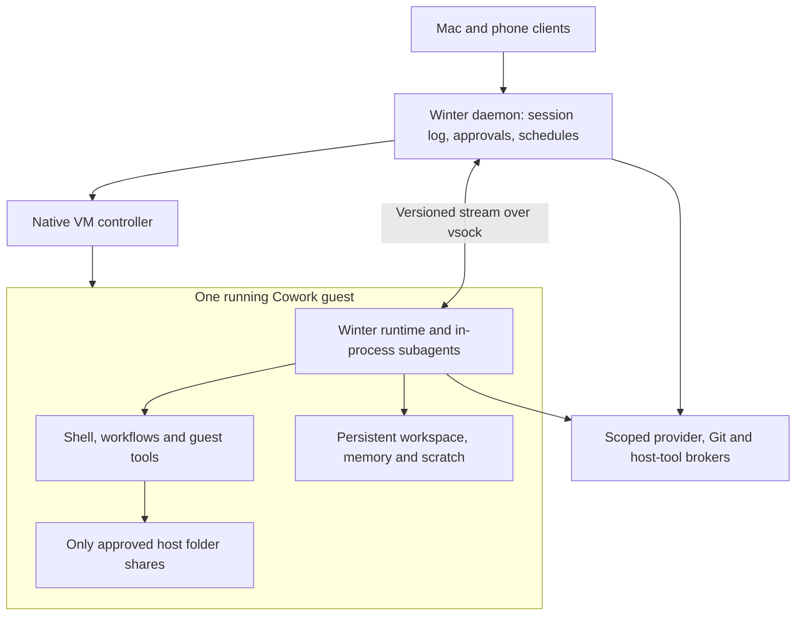

# Cowork VM research and draft decisions

Research cutoff: 2026-10-10. This is a brainstorming draft, not an approved implementation specification. No VM, guest image, scheduler change, or Cowork runtime has been implemented or benchmarked for this work.

The starting direction is a local VM containing Winter and its subagents, with either explicitly selected host folders or one or more selected GitHub repositories cloned into the guest. Cowork should reuse Code's activity vocabulary, retain its work when compute stops, and let the host daemon own future wakeups. The main design recommendation is to separate durable workspace identity from the lifetime of a running VM.

The [existing implementation map](../cowork-status.md) records the reusable groundwork. Code inspection here used Winter `0e9409cf`, agent SDK `8601190c`, runtime SDK `c5424202`, and iOS `36d6958`. The inspected Mac runs macOS 26.6.1 on arm64.

## Decisions from the first design discussion

The user selected the following behavior after the initial research:

- Standalone Cowork has one durable workspace per conversation.
- Introduce the workspace portion of Projects: a Project owns a reusable workspace. This does not approve unrelated Project UI, collaboration, or organization features. Simultaneous conversations sharing a Project workspace still need a concurrency policy.
- Changes to granted writable Mac folders take effect directly, rather than going through a staged-copy/apply flow.
- Prefer stopping and restarting a quiescent guest with files and agent state retained. Subagent history and identity must survive so `SendMessage` can logically continue a prior child after restart; retaining arbitrary process RAM is not the requested mechanism.
- Avoid a new host process for each Cowork session, preferably by placing VM control inside the existing daemon. The feasibility boundary between in-process control and Apple-managed VM execution is described below; a helper process per conversation is not the selected design.

These settle product direction, not implementation completion. Remaining decisions include the physical VM isolation boundary, Project writer concurrency, Project memory sharing, and schedule target semantics.

## Documented external behavior

### Claude Cowork and Claude Code cloud are different references

| Reference | What is documented | Implication for Winter |
| --- | --- | --- |
| Current Cowork rollout | Since October 6, new Pro/Max tasks run in the cloud; older local tasks remain local. Local folders still require online Desktop access. Team/Enterprise availability differs. [Cowork across surfaces](https://support.claude.com/en/articles/15520349-use-claude-cowork-on-web-desktop-and-mobile) | Older local-only descriptions no longer describe every Cowork session. Winter can deliberately remain local. |
| Local Cowork architecture | The agent loop, folder file tools, and local MCP servers run natively; shell/code runs in a Linux VM using Apple's framework on Mac. Cloud Cowork instead uses temporary per-session sandboxes. [Architecture overview](https://support.claude.com/en/articles/14479288-claude-cowork-architecture-overview) | Running Winter's loop inside the guest would be a deliberate design difference. |
| Why the loop moved | Anthropic initially put the loop in the VM, then moved it out so VM failures would not make the whole assistant unresponsive. Local MCP servers also moved out. [Containment engineering](https://www.anthropic.com/engineering/how-we-contain-claude) | Keep host UI, transcript, diagnostics, recovery, and scheduling responsive even if Winter's guest loop cannot run. No automatic host execution fallback is needed to achieve that. |
| Repo-only work | Claude Code cloud clones selected repositories into an isolated VM, works on session branches, pushes for review, and can open a PR. Browser sessions can select multiple repositories; pushing does not end the conversation. [Cloud quickstart](https://code.claude.com/docs/en/web-quickstart) | This is the closer reference for Winter's proposed GitHub-backed workspace. |
| Cowork GitHub limitation | The new merged Cowork/chat experience lists Add from GitHub as unsupported. This does not rule out custom connectors, but it does not establish a native Cowork clone/commit/push workspace. [Current limitations](https://support.claude.com/en/articles/16761823-claude-cowork-and-chat-are-one-claude) | Do not attribute Code cloud's Git workflow to Cowork. |
| Code cloud idle behavior | Idle environments automatically pause with files retained; a new message restores the VM and restarts Code. Setup caching is a separate baseline-environment mechanism. [Cloud environments](https://code.claude.com/docs/en/cloud-environments) | Persisted work and live process continuity are separate promises. |
| Environment reclamation | After reclamation, Code can restore conversation history into a newly provisioned environment; running subagents and shell jobs are not restored. Managed GitHub authentication uses a proxy rather than placing account credentials in the guest. [Code cloud](https://code.claude.com/docs/en/claude-code-on-the-web) | Specify precisely what Winter preserves and which operations can be retried. |
| Scheduling | Each scheduled Cowork run has its own session. Current docs describe cloud runs with no device online, but also retain a local-files/apps caveat that is not fully reconciled with the newer rollout. [Scheduled tasks](https://support.claude.com/en/articles/13854387-schedule-recurring-tasks-in-claude-cowork) | A local Winter daemon can wake a stopped guest, but cannot promise execution while its physical Mac is off or asleep. |

Public docs do not establish Cowork's internal temporary-directory layout, exact VM ownership process, save-state format, or native GitHub-only clone workspace. Account-persistent sessions/files should not be confused with a permanent cloud guest filesystem.

### Apple's relevant options

Apple advertises sub-second startup for its lightweight Linux Containerization guests, using an optimized kernel and minimal init system. Its demonstration starts a prepared image; image download, preparation, first provisioning, repository cloning, dependency installation, and Winter readiness are separate work. No Winter startup number has been measured. [WWDC25 Containerization](https://developer.apple.com/videos/play/wwdc2025/346/)

| Option | Useful properties | Constraint for this design |
| --- | --- | --- |
| Virtualization.framework directly | Native VM configuration and explicit devices/shares; Linux guests and, separately, macOS guests. [Virtualization](https://developer.apple.com/documentation/virtualization) | More guest image, init, storage, networking, and lifecycle machinery to own. |
| Containerization Swift package | Linux VM-backed execution with image/process support; its native backend constructs a `VZVirtualMachine`. [Native backend](https://github.com/apple/containerization/blob/0.47.0/Sources/Containerization/VZVirtualMachineInstance.swift) | A native integration layer is needed for Winter's Bun daemon; no first-party TypeScript binding was established. |
| Apple's `container machine` | Persistent Linux environments, init systems, services, automatic boot on execution, retained disk across stop/start. [Machine guide](https://github.com/apple/container/blob/1.5.0/docs/container-machine.md) | Defaults share the whole home read/write and allocate half host RAM. The documented home setting is rw/ro/none, not a selected-folder list. |

A Linux guest does not supply Xcode, macOS application testing, or native macOS computer use. Those require a separate explicitly authorized backend or host capability.

The inspected public release is `container` 1.5.0, with documented Apple silicon/macOS 26 support. This is compatible with the stated platform floor on paper, not a live compatibility result. [Pinned requirements](https://github.com/apple/container/blob/1.5.0/README.md#requirements)

The machine service's inspected configuration mounts its internal files and, optionally, the whole host home; it also enables SSH forwarding. That is not the proposed Cowork access boundary. Prefer a custom native Containerization integration with explicit shares, or evaluate an ordinary long-lived container configuration, rather than adopting the machine defaults. [Machine configuration](https://github.com/apple/container/blob/1.5.0/Sources/Services/MachineAPIService/Server/MachinesService.swift#L635)

“Embedded in the daemon” needs two meanings separated. A native bridge could hold the VM controller in the existing Bun daemon, with VM operations dispatched onto the controller's serial queue. That avoids an additional Winter-owned controller process per conversation. The native host executable needs the virtualization entitlement. This is feasible in principle, not a completed integration. [Apple entitlement](https://developer.apple.com/documentation/virtualization/adding-the-virtualization-entitlement-to-your-project), [VZVirtualMachine](https://developer.apple.com/documentation/virtualization/vzvirtualmachine)

It does not establish that the VM itself executes wholly in the daemon's PID. The installed framework contains Apple's `com.apple.Virtualization.VirtualMachine` XPC service, configured for multiple instances; no public VZ switch to eliminate that backing service was found. Exact host PID counts have not been measured. The lower-level Hypervisor API explicitly allows only one VM per process, so it does not provide multiple independently hardware-isolated VMs inside a single daemon PID either. [Hypervisor](https://developer.apple.com/documentation/hypervisor?language=objc)

If avoiding a VM-backed host process per conversation is the overriding constraint, one shared VM with separate guest containers is an alternative, with a different isolation boundary. The pinned Containerization 0.47.0 source includes experimental `LinuxPod`: containers have separate root filesystems/processes but share one VM's CPU, memory, and network. This shares a guest kernel and is not equivalent to a hardware VM per conversation. It is a research option, not an accepted choice. [LinuxPod source](https://github.com/apple/containerization/blob/bc994b88df46207fad7775b0eabc51947e315881/Sources/Containerization/LinuxPod.swift#L26-L30)

Pause, stop, and saved-state restore also differ. Pause retains execution state but does not establish RAM reclamation. Stop/start can retain disk while replacing guest processes. VZ saved-state support requires a compatible configuration and separate handling of external resources; support for the intended Linux/virtiofs/vsock combination remains unverified. Do not make RAM restoration a v1 prerequisite. [Save/restore validation](https://developer.apple.com/documentation/virtualization/vzvirtualmachineconfiguration/validatesaverestoresupport()), [WWDC23 save/restore](https://developer.apple.com/videos/play/wwdc2023/10007/)

## Proposed Winter architecture

This proposal follows the requested guest-side loop. Anthropic's native-loop design is an alternative with better agent availability during VM failures, rather than evidence that a guest-side loop cannot work.

The daemon owns durable session identity, the canonical event log, permission grants, VM lifecycle, scheduling, and account credential authority. The guest owns agent execution, subagents, filesystem/shell tools, and guest-local work. A crashed guest must leave a readable transcript and a recoverable error in the app; it must not silently rerun the task with host filesystem privileges.

The SDK already has a suitable custom process-shaped transport: stdin/stdout, exit/kill, and `pid: null` for virtual handles. Its contract explicitly says a VM spawner must not forward the Mac host PID as the runtime's parent PID. A guest supervisor needs guest-local ancestry and connection-loss handling instead. [SDK transport](https://github.com/yanlingLabs/winter-agent-sdk/blob/8601190c/packages/sdk/src/transport.ts#L18)

Subagents should stay in the session's guest and inherit its access ceiling. Today's SDK subagents are in-process engine instances; their shells and workflows may spawn processes. There is no need for a VM per subagent or nested virtualization. Different subagent prompts do not create separate OS isolation boundaries. [Child engines](https://github.com/yanlingLabs/winter-agent-sdk/blob/8601190c/packages/runtime/src/subagents/child-engine.ts#L1)

### Workspace and persistence contract

Accepted ownership: a standalone Cowork conversation owns its workspace; a Project owns a reusable workspace used by its conversations. Keep conversation identity, workspace identity, and running VM identity separate. Proposed execution default is one active writer lease per workspace; whether Project conversations run concurrently remains open. Physical VM sharing is also undecided because of the host-process requirement above.

| Data | Proposed location/ownership | Survives normal VM stop? |
| --- | --- | --- |
| Base OS and tooling | Versioned, shared immutable image | Yes; image updates do not silently reset workspace data |
| Git checkouts and uncommitted files | Workspace-owned writable guest storage, stable `/workspace/repos/<repo-id>` paths | Yes |
| Workspace manifest | Host-owned: repo IDs/remotes/base refs, selected grants, primary cwd, image version | Yes |
| Folder-backed work | Explicit virtiofs shares at stable `/workspace/folders/<grant-id>` paths | Host files remain; existing grants are revalidated on restart |
| Cowork MEMDIR | Persistent workspace-scoped guest directory | Yes; broader sharing with Code/Chat memory requires a separate decision |
| Session scratch | Persistent guest scratch exposed as `TMPDIR` | Yes; cleanup is a separate retention policy |
| OS `/tmp` | Disposable guest boot data | No promise across stop/reboot |
| Transcript and approvals | Canonical host event log, with guest durable replay state | Yes |
| Subagent history and identity | Durable guest transcripts, metadata, provider state, and a complete restoration record | Yes; logical continuation needs the SDK restoration work below |
| Shells, sockets, active engine generations | Live guest execution | No after cold stop; they must settle before automatic stop |
| Deliverable artifacts | Persistent output area and explicit export/read bridge to host UI | Yes |

The proposed persistent scratch gives Cowork its own tmp directory without treating guest OS `/tmp` as durable storage. Scratch retention and cleanup policy remain open. Valid persisted folder grants mount automatically after revalidation; revoked or unavailable grants block dependent work, with a new prompt only when consent is actually needed.

For folder-backed work, select at least one grant and its read-only/read-write policy. No automatic home, SSH agent, host socket, dotfile, or Keychain share. Writable mounts edit real host files immediately; VM disk rollback does not roll those files back. Apple provides explicit shared-directory primitives, but a read-write-no-delete promise needs additional enforcement rather than being inferred from ordinary writable virtiofs. [Shared directories](https://developer.apple.com/documentation/virtualization/shared-directories)

For repository-backed work, connecting GitHub authorizes account access but is not itself a workspace: explicitly select one or more repositories and starting refs, clone them into the guest disk, and record a branch per repository. Use a session branch by default. Keep dirty files and local commits across stop/start, do not re-clone on every turn, and do not reset to the remote when reopening. Local filesystem and Git operations remain available offline; agent turns still need access to their configured model provider unless it is available locally. Pushes wait for connectivity and authorization.

Each repo in a multi-repo workspace needs its own remote, base ref, current branch, dirty state, and publication authority. Cloning selected repositories does not implicitly authorize every repository accessible to the account. Git commit, branch push, PR creation, and merge are separate actions; the eventual product's permission policy should state which are pre-authorized. This development session's PR permission is not a default policy for future Cowork users.

For v1, avoid overlapping writable grants across Winter sessions unless the user explicitly chooses that concurrency. Existing directory “locks” mean the assignment cannot change after writing; they are not cross-process writer locks. External editors can still modify shared files. Grant revocation must remain possible independently of preserving the historical directory record. [Directory model](../../packages/core/src/sessions/dirs.ts)

### Activity and VM power

Keep Code's `active`, `background`, `idle`, and `archived` semantics; do not use those labels as a VM power switch. Existing derivation can report active because a client is attached, or background because a stored background flag is set, without a running turn. [Activity derivation](../../packages/core/src/sessions/activity.ts#L205)

The VM needs separate internal states such as stopped, starting, running, quiescing, and failed. Proposed automatic stop rule: no turn, no subagent, no detached process/workflow/monitor, no pending tool or permission handshake, no queued input, no filesystem operation, and guest/host agreement that durable state is flushed. An unresponsive guest is unknown, not idle. A new message or due schedule cancels quiescing or starts a new incarnation after stop.

| Situation | Proposed compute behavior |
| --- | --- |
| Window open, no work | May stop after a short measured grace period; conversation remains available |
| Window closed, work running | Continue according to existing Code app/phone detachment behavior |
| Subagent or detached shell still running | Keep the VM running regardless of whether the parent turn returned |
| Future cron due, no current work | Keep only the host schedule; the VM may be stopped |
| Archived session | Stop once safe; archive retains work. Whether schedules pause or may target it is an explicit product decision |
| User forces a stop | Record interrupted work and recovery status; do not claim live jobs were preserved |

Reuse Code's actual enforcement, not an oversimplified “every detach aborts” rule: the last terminal attachment can abort a human-started turn, while app/phone detachment and automated turns have different handling. [Detach enforcement](../../packages/core/src/sessions/activity-enforcement.ts#L251)

A cold restart should resume durable Winter state and files, including addressable subagents. It does not resume arbitrary OS processes. Exact checkpointing, interrupted tool reconciliation, guest event acknowledgment, and crash recovery must be specified before claiming lossless VM sleep.

### Subagents after a cold restart

Implementation follow-up: [agent SDK PR 2](https://github.com/yanlingLabs/winter-agent-sdk/pull/2), commit `594002a6`, implements continuation for children carrying the new execution snapshot. Named children retain identity and history but use the current trusted definition and persona, with the stricter saved/current authority; removed definitions refuse continuation. Forced parent modes follow fresh-spawn semantics, and child storage uses the parent's recorded project key across directory-override changes. Review fixes also cover interrupted tool history after an actual process kill, validated worktree roots, and descendant teardown before the parent context closes. The prior fix revision passed full CI; the latest revision has passing runtime, build/typecheck, and targeted source/compiled checks, with external re-review and fresh CI pending. It has not been released or integrated into Winter. Older records without the required snapshot remain readable but refuse continuation. The source observations below describe the audited pre-fix revision.

The user's reasoning is correct as a design: persisting a child conversation makes logical continuation possible without preserving its original engine in RAM. The desired sequence is to retain the guest's durable store, reopen the parent with the same identity, reconstruct its child roster and execution contexts, and let `SendMessage` to an existing child ID start a new generation from that child's history.

At the audited pre-fix revision, the SDK only completes part of that sequence. It writes child JSONL transcripts, metadata and provider-state sidecars, then reconstructs child IDs/names and recorded status on parent resume. However, `restoredChildHandle.resume()` explicitly returns `unavailable` because restarting that child across a parent-process restart is unimplemented. A child whose handle still exists in the same parent process can reread its transcript and start another generation; that is a different path. [Cold-restored handle](https://github.com/yanlingLabs/winter-agent-sdk/blob/8601190c/packages/runtime/src/subagents/restore.ts#L31), [same-runtime continuation](https://github.com/yanlingLabs/winter-agent-sdk/blob/8601190c/packages/runtime/src/subagents/child-engine.ts#L1795)

At that revision, the durable child record is not the complete construction snapshot: parts of the persona, tools, MCP configuration, isolation/workspace and callback bindings live in the current handle's closures. Cowork's contract therefore needs a restorable execution record, handles rebound to the new parent runtime, current permission/credential validation, and preserved workspaces. Those restore tests explicitly expect the refusal, so durable files alone must not be reported as working post-restart `SendMessage`. Acceptance needs a real parent-process restart followed by continuation of the same child ID, with its earlier context intact. [Restore tests](https://github.com/yanlingLabs/winter-agent-sdk/blob/8601190c/packages/runtime/src/subagents/restore.test.ts#L126)

### Daemon-owned scheduling

Recommended: one authoritative host schedule store with canonical job IDs. Guest schedule tools should await a durable host acknowledgment before reporting success. Listing and deletion must read that same authority. A stopped guest cannot own the timer that starts it.

Store the target session/workspace, prompt, one-shot or recurring intent, timezone, next due time, current grant requirements, overlap policy, missed-run policy, and durable run status. Proposed defaults: queue behind current work, no overlapping runs against one writable workspace, coalesce missed recurring occurrences after the Mac resumes, and keep one-shot delivery distinct. Persist enough run state to avoid blindly repeating an external side effect after a daemon crash.

Agent-created wakeups naturally target the same session. Existing user routines start fresh sessions; whether Cowork routines instead reuse a conversation or create a new conversation on retained workspace data remains a product choice. The spec must choose this explicitly rather than inheriting today's Code runner accidentally.

Local host scheduling only operates when the Mac and daemon can run. Waking a stopped guest is separate from waking a sleeping Mac. Initial behavior should queue/report missed runs rather than promise an always-online cloud service.

## Current Winter gaps that affect the design

These are static source findings, not live reproductions. They are recorded for the specification; no fixes are included in this research.

| Finding | Evidence | Required design consequence |
| --- | --- | --- |
| No validated Linux guest artifact | SDK build compiles for its current native target; shipped platform fallback is darwin-arm64. [Build](https://github.com/yanlingLabs/winter-agent-sdk/blob/8601190c/scripts/build-runtime.ts#L155), [transport](https://github.com/yanlingLabs/winter-agent-sdk/blob/8601190c/packages/sdk/src/transport.ts#L47) | Define Linux ARM64 packaging, provisioning, updates, and guest smoke checks. |
| Shell sandbox is macOS-specific | Required sandbox execution refuses when macOS `sandbox-exec` is unavailable. [Sandbox spawn](https://github.com/yanlingLabs/winter-agent-sdk/blob/8601190c/packages/runtime/src/sandbox/spawn.ts#L258) | Add an explicit Linux/VM execution posture; do not silently turn off a required sandbox. |
| Idle is weaker than no guest work | [WinterSession.idle](../../packages/core/src/runtime-sdk/winter-session.ts#L936) checks in-flight turns; [daemon background work](../../packages/core/src/daemon.ts#L2110) uses child-agent roster entries. | Guest-wide task occupancy and a drain handshake must cover shells, workflows, monitors, and pending requests too. |
| Restored subagents are addressable but cannot restart | [Restored child handle](https://github.com/yanlingLabs/winter-agent-sdk/blob/8601190c/packages/runtime/src/subagents/restore.ts#L42) refuses `resume()` after a parent runtime restart. | Implement logical child continuation from durable state before automatic VM cold-stop can meet the selected subagent behavior. |
| Cron already reaches the host, incompletely | [Cron sink](../../packages/core/src/runtime-sdk/sinks.ts#L304) mirrors successful tool creates into routines. | Reuse host ownership, but replace eventual result mirroring with one authoritative acknowledged schedule operation. |
| One-shot intent is lost | [PendingCronCreate/parser](../../packages/core/src/runtime-sdk/sinks.ts#L184) retains only cron/prompt, ignoring `recurring`; successful creates reach the recurring RoutineStore. | Preserve one-shot versus repeating semantics. The current comment claiming one-shots are excluded does not match the parser. |
| Schedule ID/list authority is split | [ID mapping](../../packages/core/src/runtime-sdk/sinks.ts#L273) is a process-local Map; CronList remains child-side. Host creation can fail after the child has already answered success. | Persist canonical identities and return success only after durable host acceptance. |
| ScheduleWakeup has no verified wake mechanism | The inspected tool stores only ID/time in a session Map and returns success; no firing producer was found in the SDK/runtime audit. [Wakeup executor](https://github.com/yanlingLabs/winter-agent-sdk/blob/8601190c/packages/runtime/src/tools/impl/schedule-wakeup.ts#L56) | Treat it as an integration gap, not an existing VM-wakeup facility. |
| Routines currently create Code sessions | [Routine runner](../../packages/core/src/routines/runner.ts#L66) creates a fresh session without Cowork mode/workspace/guest identity. | A Cowork target needs explicit persisted bindings and resume/create policy. |
| Paths assume the host filesystem | [Run-home validation](https://github.com/yanlingLabs/winter-runtime-sdk/blob/c5424202/src/run-home/apply.ts#L57) expects real local roots/cwd. Host capabilities use host roots. | Materialize guest run homes and use explicit path/grant translation; never pass Mac symlinks or arbitrary guest paths through unchanged. |
| Existing credential brokerage returns material | [Credential session view](../../packages/core/src/runtime-sdk/host-credentials.ts#L175) removes refresh tokens but can send API/access-token material to the runtime. | Host Keychain ownership alone does not keep credentials out of the guest. |

For the proposed no-long-lived-credentials-in-guest posture, use a host provider/Git broker with a revocable capability bound to the session and its allowed providers, models, and repositories. The host validates destinations and must not forward authentication through arbitrary redirects. This is additional work, not a property of today's credential callback. Do not assume every provider offers short-lived scoped tokens. Host-local model endpoints also need deliberate mapping: guest localhost is not the Mac's localhost. Guest network egress is a separate policy: retaining keys on the host does not by itself control where granted document contents can be sent.

Guest paths and host capabilities require separate authority. Filesystem/shell work should execute in the guest. A host office, browser, or computer-use capability must be explicitly offered and authorized, with bounded artifact transfer or approved grant IDs. An unrestricted host shell/tool proxy would undo the selected-folder isolation boundary.

## Draft decision ledger

| Decision | Suggested starting point | Status |
| --- | --- | --- |
| Execution location | Winter loop and subagents in a local Linux ARM64 guest | User direction; Linux choice proposed |
| VM ownership | Prefer native VM controller inside the existing daemon; avoid a Winter helper per conversation | User requirement; Apple backing-process constraint unresolved |
| VM technology | Evaluate Containerization before building all VZ device/image plumbing directly | Proposed; no runtime validation yet |
| Workspace | Per-conversation for standalone Cowork; reusable workspace for Projects | Accepted; Project concurrency remains open |
| Access | Direct writes to explicitly granted folders, or selected repos cloned into guest storage | Accepted; no ambient home/SSH sharing remains proposed enforcement |
| Memory and temp | Workspace-scoped persistent MEMDIR and scratch; disposable OS tmp | Proposed; sharing/retention choices remain open |
| Resource release | Quiescent cold stop, retained files and durable parent/child continuation | Accepted direction; child cold-resume currently requires SDK work |
| Scheduling | Durable host authority, VM start on demand, no overlapping workspace runs | Proposed |
| Host tools | Explicit narrow capabilities, no automatic guest-to-host shell fallback | Proposed |
| Git publication | Session branches; separate commit/push/PR/merge authority | Proposed |

The next discussion should resolve whether Apple's VM backing processes are acceptable or a shared VM is required, whether Project conversations may write concurrently, Project memory scope, and schedule target semantics. Direct host-folder writes and workspace ownership are already settled. Only then should this draft become an implementation spec with acceptance gates.

## Research limits and later validation

No Apple VM was launched, no image was downloaded or built, and no Linux Winter process was run. Sub-second Winter readiness, resource budgets, Linux shell/tool support, dynamic mount revocation, filesystem durability, network enforcement, and save/restore compatibility remain unverified.

Once implementation is authorized, evaluate prepared-image boot separately from first provisioning and repo setup; test VM crashes during tools, daemon restarts during scheduling, background tasks after parent completion, expired credentials on resume, revoked folder grants, dirty repo preservation, and Mac sleep/wake behavior. These are proposed future experiments, not results from this research.
